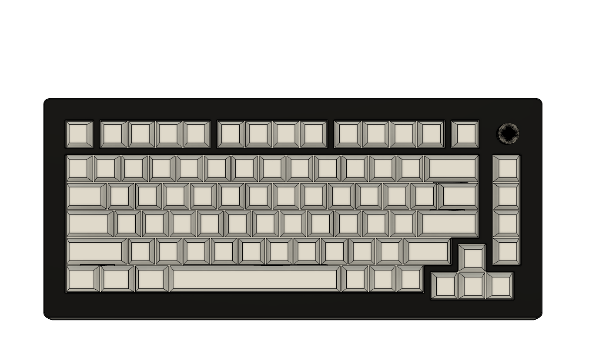
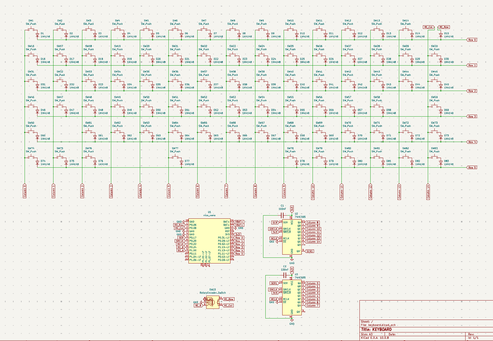
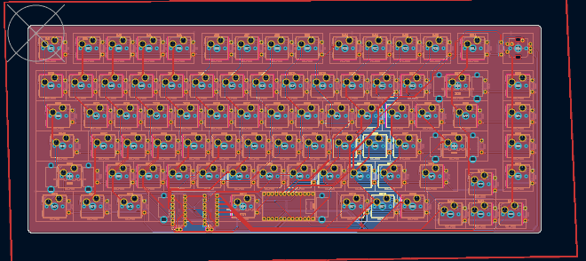
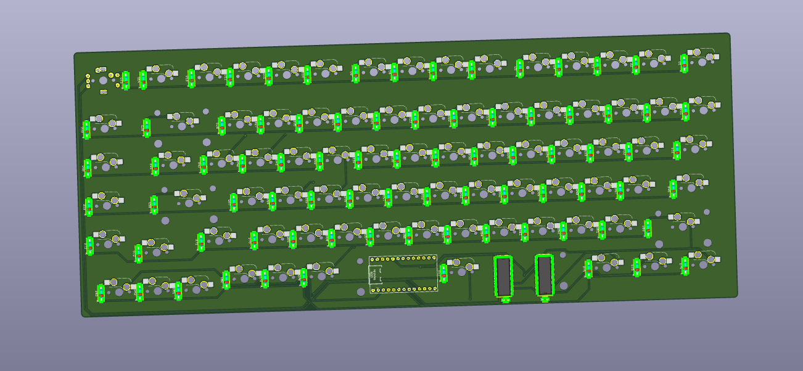
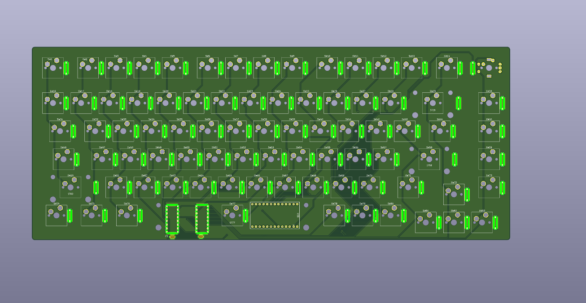
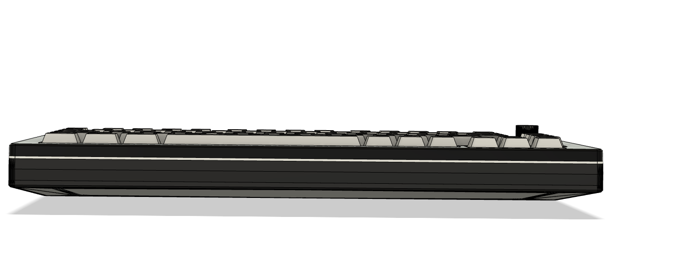
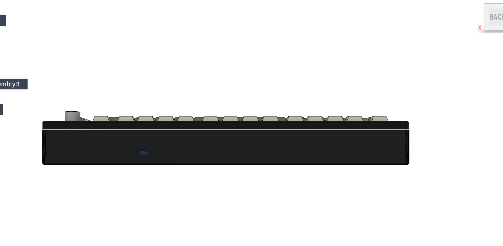

# My Lovely Keyboard

My Lovely Keyboard is a custom 75% mechanical keyboard with a hot-swap MX PCB, two rotary encoders with push buttons, and 3D-printed parts. The build pairs Akko Creamy Cyan clicky switches with SoulCat Cowgirl keycaps.

## PCB

The design uses a Pro Micro nRF52840 development board, four 74HC595 shift registers, and 1N4148 switching diodes for the key matrix. Jerrzi MX hot-swap sockets let you swap individual switches without desoldering them.

The hardware plan also includes two Hongyan EC11H rotary encoders with push buttons and a single-cell LiPo with a TP4056 charging module.

### Schematic and board layout

### PCB renders

## Case

The build includes 3D-printed parts and SSS Fourwrap V2 PCB screw-in stabilizers. The stabilizer kit includes four 2U wires and wires for both 6.25U and 7U spacebars.

## Bill of Materials

| Part | Purpose | Purchase quantity | Total (INR) | Total (USD, approx.) |
|---|---|---:|---:|---:|
| [Akko Creamy Cyan switches](https://stackskb.com/store/akko-creamy-cyan-switch-pack-of-45-pre-order/) | Clicky MX switches | 2 packs of 45 | ₹2,598.00 | $28.00 |
| [Jerrzi MX hot-swap sockets](https://neomacro.in/products/jerrzi-mx-hotswap-sockets) | Removable switch mounting | 9 packs of 10 | ₹450.00 | $4.85 |
| [Pro Micro nRF52840](https://robu.in/product/promicro-nrf52840-development-board/) | Main controller | 1 | ₹899.00 | $9.69 |
| [74HC595 shift register](https://robocraze.com/products/8-bit-serial-to-parallel-shift-register-ic-74hc595) | Expand digital outputs | 4 | ₹60.00 | $0.65 |
| [3.7 V 10,000 mAh LiPo](https://makerbazar.in/products/single-cell-3-7v-10000mah-lipo-battery) | Battery power, variant without BMS or wires | 1 | ₹349.00 | $3.76 |
| [TP4056 1 A module](https://makerbazar.in/products/tp4056-1a-li-ion-lithium-battery-charging-module?variant=45459125567728) | Single-cell charging | 1 | ₹18.00 | $0.19 |
| [Hongyan EC11H rotary encoders](https://robu.in/product/hongyan-ec11h-7ce20p1zy15f7-rotary-encoder-with-push-button-switch-vertical-plug-in-5-pin/) | Rotary and push-button inputs | 2 | ₹116.00 | $1.25 |
| [SS-12D00 1P2T slide switches](https://robu.in/product/1-month-warranty-255/) | Slide switches | 6 | ₹11.34 | $0.12 |
| [SSS Fourwrap V2 stabilizers](https://neomacro.in/products/sss-fourwrap-v2-stabilizers) | Support wider keys | 1 kit | ₹1,059.00 | $11.41 |
| [PCB fabrication](https://jlcpcb.com/) | Custom keyboard PCB | 1 order | ₹3,692.77 | $39.80 |
| [1N4148 switching diodes](https://robu.in/product/1n4148-1w-zener-diode-pack-of-50/) | Key matrix isolation | 120 | ₹128.00 | $1.38 |
| [SoulCat Cowgirl keycaps](https://neomacro.in/products/soulcat-cowgirl-keycaps-pre-order) | 141-piece MOA-profile PBT keycap set | 1 set | ₹2,039.00 | $21.97 |
| 3D-printed parts | Mechanical assembly | Pending | Pending | Pending |
| **Estimated parts subtotal** | | | **₹11,420.11** | **$123.07** |
| **Shipping allowance** | | | **₹119.81** | **$1.29** |
| **Total allocated** | | | **₹11,539.92** | **$124.37** |

